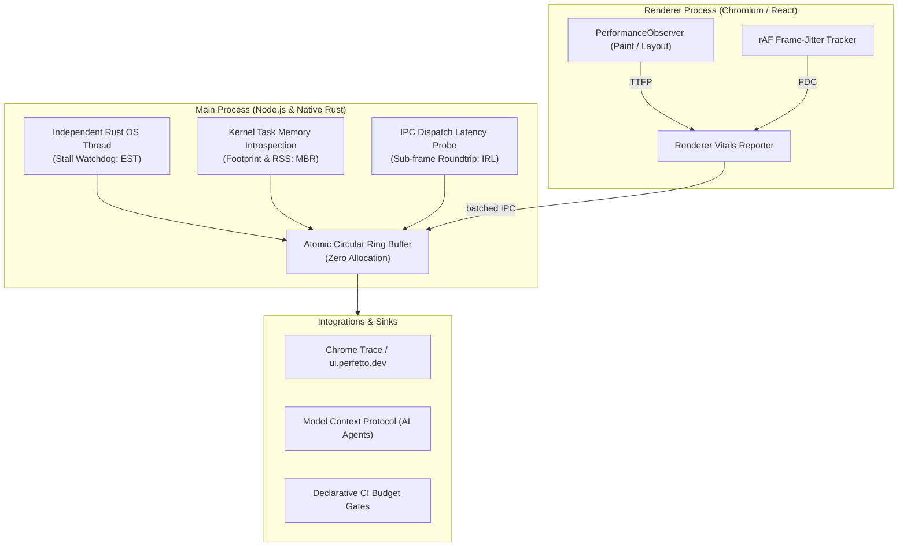

# app-vitals ⚡

> **Zero-overhead, Rust-powered Core Desktop Vitals for Electron and native applications.**  
> Measure, monitor, and enforce SLAs across the 5 Core Vitals: **EST**, **IRL**, **TTFP**, **MBR**, and **FDC**.

---

## The Problem in Desktop Software

In web development, every engineer knows Google's **Web Vitals** (`LCP`, `INP`, `CLS`). They give engineering teams a shared vocabulary and automated CI budgets for frontend health.

**Desktop and Electron applications have had no equivalent standard.** When an Electron app feels "sluggish," teams argue in circles without knowing whether the problem is main-process event-loop freezes, contextBridge IPC serialization overhead, native memory leaks, or renderer frame drops during virtualized scrolling.

**`app-vitals`** defines and measures the **5 Core Desktop Vitals** backed by an independent, zero-overhead **Rust native engine**:



---

## The 5 Core Desktop Vitals

| Vital | Full Name | Standard Good Threshold | What It Captures |
|---|---|:---:|---|
| **`EST`** | **Event Loop Stall Time** | $\le 16\text{ ms}$ (p95) | Main-process freezes caused by synchronous `fs` I/O, heavy crypto, or blocking loops. Measured via an independent native OS thread. |
| **`IRL`** | **IPC Roundtrip Latency** | $\le 16\text{ ms}$ (1 frame) | Duration from renderer `ipcRenderer.invoke()` to main handler reply. Catches slow handlers and bloated serialization. |
| **`TTFP`** | **Time to First Pixels** | $\le 400\text{ ms}$ | Elapsed time from app/window spawn to first meaningful contentful paint in the renderer viewport. |
| **`MBR`** | **Memory Bloat Ratio** | $\le 1.8\times$ | $\text{MBR} = \frac{\text{OS Physical Memory Footprint}}{\text{V8 JS Heap Total}}$. Catches native C++/Rust/GPU leaks (e.g. Sharp, WebGL, SQLite) that V8 ignores. |
| **`FDC`** | **Frame Drop Rate** | $\le 1.0\%$ | Viewport and animation stuttering during high-speed scrolling or keyboard culling navigation. |

---

## Quickstart

### 1. Installation

```bash
npm install app-vitals
```

### 2. Main Process Setup (1 Line)

```javascript
// In main.js / main.ts
const { app, ipcMain } = require('electron')
const { initAppVitals } = require('app-vitals')

const vitals = initAppVitals({
  app,
  ipcMain,
  budgets: {
    maxEstMs: 50,     // Fail if event loop freezes > 50ms
    maxIrlMs: 25,     // Fail if p95 IPC latency exceeds 25ms
    maxMbrRatio: 2.0, // Fail if native memory exceeds 2x JS heap
  },
  onViolation: (violation) => {
    console.warn('[Vitals Alert]', violation)
  },
})

// Query real-time vitals summary anytime:
const summary = vitals.getSummary()
console.log(summary)
```

### 3. Renderer Process Setup

```javascript
// In renderer index.tsx / index.html
import { initRendererVitals } from 'app-vitals'

initRendererVitals({
  reportIntervalMs: 3000, // Flushes frame drop rate every 3 seconds
})
```

---

## AI Agent & Model Context Protocol (MCP) Integration

`app-vitals` natively exports agent-callable tools compatible with [`electron-mcp-bridge`](https://github.com/rudraptpsingh/electron-mcp-bridge) and any MCP client (Claude Desktop, Cursor, Antigravity):

```javascript
const { createVitalsMcpTools } = require('app-vitals')
const { setupMcpBridge } = require('electron-mcp-bridge')

setupMcpBridge({
  app,
  ipcMain,
  tools: [
    ...createVitalsMcpTools(vitals),
  ],
})
```

AI agents can now autonomously inspect app vitals:
```json
{
  "method": "tools/call",
  "params": {
    "name": "app:assert_core_vitals_budgets",
    "arguments": { "maxEstMs": 50, "maxIrlMs": 25 }
  }
}
```

---

## Perfetto & Chrome Trace Export

Export your application's vitals directly into Google Chrome's standard Trace Event format (`.json`) loadable in [ui.perfetto.dev](https://ui.perfetto.dev) or `chrome://tracing`:

```javascript
// On quit or on demand:
vitals.exportTrace('./diagnostics/session.trace.json')
```

---

## Why Rust?

JavaScript watchdogs run on Node.js's libuv event loop. **If the event loop freezes, the watchdog freezes too.**

`app-vitals` compiles a native Rust engine (`app-vitals-native`) that:
1. Spawns an independent native OS thread with high-precision monotonic clock sampling (`std::time::Instant`).
2. Directly inspects Mach kernel VM task structures (`task_info` on macOS) and `/proc/self/statm` on Linux in microseconds.
3. Records telemetry into an atomic lock-free ring buffer with **zero V8 heap allocations and zero GC pressure**.
4. Includes a seamless, zero-dependency pure-JS fallback for unsupported architectures.

---

## License

MIT © Rudra Pratap Singh
